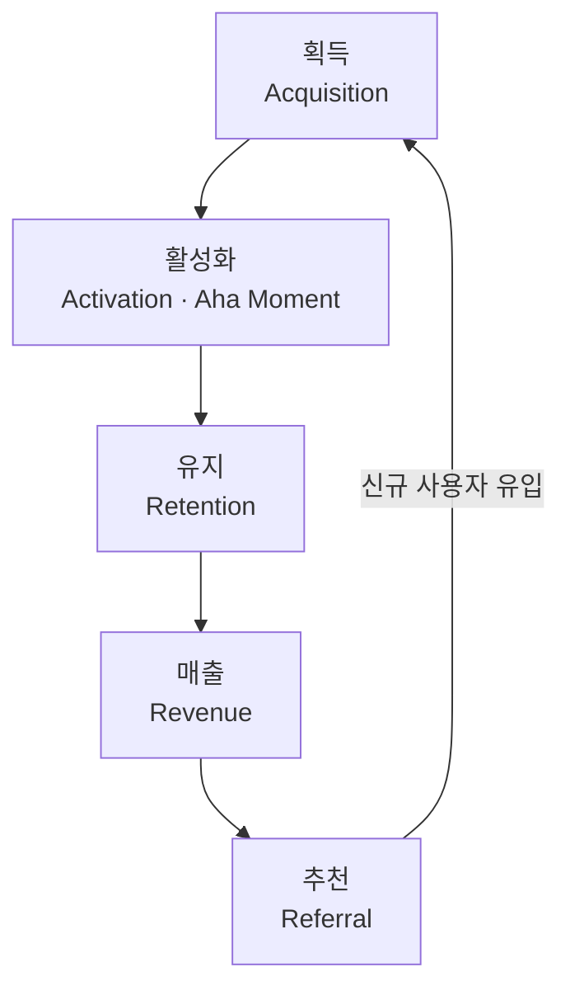
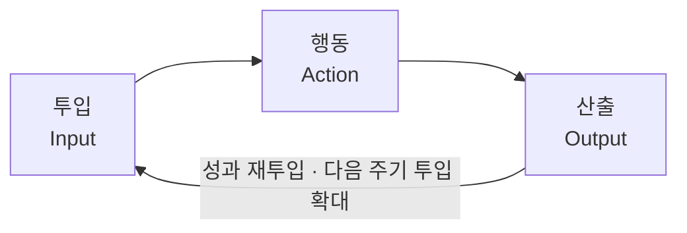

## 연관 키워드

- **그로스 해킹(Growth Hacking)**, **AARRR**, **해적 지표(Pirate Metrics)**
- **PMF(Product-Market Fit)**, **바이럴 루프(Viral Loop)**, **A/B 테스트**
- **북극성 지표(North Star Metric)**, **LTV(Lifetime Value)**, **CAC(Customer Acquisition Cost)**

## Ⅰ. 그로스 해킹의 개요

- 핵심 요약 : **제품·데이터·실험**을 결합하여 저비용으로 고성장을 이끄는 데이터 주도 마케팅 기법.
- 개념 : 대규모 전통적 광고 예산에 의존하지 않고, 제품 개발과 마케팅의 경계를 허물어 **데이터 분석**, 신속한 **A/B 테스트**, 사용자 행동 퍼널 분석을 통해 제품 자체의 고성장 (Growth)을 이끌어내는 데이터 주도 마케팅 기법.
- 배경 및 필요성 : 스타트업의 자본 한계와 사용자 반응의 실시간 추적 가능성에 힘입어 **제품-시장 적합성**(PMF)을 저비용으로 검증하고 성장을 견인할 필요성 대두.
- 주요 목적 : 최저 비용으로 신규 사용자 획득, 제품 내 **바이럴 루프(Viral Loop)** 형성, **고객 생애 가치(LTV)** 극대화 및 이탈률 최소화.

## Ⅱ. 그로스 해킹의 특징 및 장점

- 핵심 요약 : 제품·데이터·실험·협업의 특징을 **CAC 절감**, 빠른 학습, **복리 성장**의 장점으로 연결하는 성장 운영체계.
1. **제품 중심(Product-Led)** : 제품 자체에 온보딩과 추천 장치를 내재화하여 고객 획득비용 (CAC) 절감.
2. **데이터 기반(Data-Driven)** : 사용자 행동과 코호트 데이터를 근거로 의사결정하여 직관 편향과 실패 비용 최소화.
3. **실험 문화(Experimentation)** : 작은 가설을 A/B 테스트로 신속하게 검증하여 학습 속도와 성공 확률 향상.
4. **크로스펑셔널 팀(Cross-functional)** : 개발자·디자이너·데이터 분석가·마케터가 원팀으로 협업하여 부서 간 인계 지연과 실행 주기 단축.
5. **퍼널 전 단계 최적화** : 획득부터 활성화·유지·매출·추천까지 관리하여 전환율과 고객 생애 가치 (LTV) 향상.
6. **성장 루프(Growth Loop)** : 산출물을 다음 주기의 입력으로 재투입하여 광고비 의존도를 낮추고 누적 성장 효과 확보.

## Ⅲ. 그로스 해킹의 구조 (흐름)

- 핵심 요약 : **AARRR 퍼널** 흐름과 **Growth Loop 복리 순환**의 이중 구조.
- AARRR 해적 지표 (Pirate Metrics) 퍼널과 Growth Loop 구조.

```text
[ AARRR Funnel and Referral Loop ]

+-------------+
| Acquisition |<-----------------------------------+
+------+------+                                    |
       |                                           |
       v                                           |
+------+------+                                    |
| Activation  |  -- Aha Moment                     |
+------+------+                                    |
       |                                           |
       v                                           |
+------+------+                                    |
|  Retention  |                                    |
+------+------+                                    |
       |                                           |
       v                                           |
+------+------+                                    |
|   Revenue   |                                    |
+------+------+                                    |
       |                                           |
       v                                           |
+------+------+                                    |
|  Referral   |------ new users -------------------+
+-------------+
```

**시각화 — AARRR 퍼널과 추천의 재유입**



```text
[ Compound Growth Loop ]

+--------+     +--------+     +--------+
| Input  |---->| Action |---->| Output |
+---+----+     +--------+     +---+----+
    ^                               |
    |                               v
    +------- Reinvestment <---------+
        (larger input per cycle)
```

**시각화 — 산출물 재투입에 따른 복리 성장**



- Acquisition (획득) : 사용자가 서비스를 어떻게 처음 접하고 유입되는가? (CAC, Customer Acquisition Cost; 방문자 수).
- Activation (활성화) : 사용자가 서비스의 핵심 가치 (Aha Moment)를 경험했는가? (회원가입, 첫 구매).
- Retention (유지) : 사용자가 서비스를 이탈하지 않고 지속적으로 재방문하는가? (재방문율, 코호트 분석).
- Revenue (매출) : 사용자가 실제 유료 결제를 통해 비즈니스 가치를 창출하는가? (ARPU, Average Revenue Per User; LTV).
- Referral (추천) : 만족한 사용자가 자발적으로 다른 사용자에게 서비스를 추천하는가? (바이럴 계수).

## Ⅳ. 전통적 마케팅과의 비교

- 핵심 요약 : **광고비·매체 중심**에서 **제품·데이터·실험 중심**으로의 전환.
- 전통 마케팅과 그로스 해킹의 대비 구조.

```text
[ 전통 마케팅 ] 광고비·매체 중심
        ↓ 전환
[ 그로스 해킹 ] 제품·데이터·실험 중심
```

| 비교 항목 | 전통적 마케팅 | 그로스 해킹 |
|---|---|---|
| 주요 수단 | TV, 신문, 옥외광고 등 대규모 매체 중심 | 제품 자체의 기능, 바이럴 장치, 인앱 메시지 |
| 의사결정 방식 | 마케터의 직관, 광고 대행사 크리에이티브 | 데이터 분석, 통계적 유의성, A/B 테스트 결과 |
| 조직 체계 | 마케팅 부서와 개발/제품 부서의 분리 | 개발자, 디자이너, 데이터 분석가, 마케터의 원팀(스쿼드) |
| 핵심 초점 | 브랜드 인지도 및 획득 (Acquisition) 단계 집중 | 퍼널 전 단계 (Activation, Retention, Referral) 종합 최적화 |

## Ⅴ. 그로스 해킹의 한계와 방안

- 핵심 요약 : **허상 지표·다크 패턴·통계 오류·성장 부채**를 북극성 지표, 윤리 검토, 실험 거버넌스, 부채 예산으로 통제.

| 한계 | 원인·영향 | 대응 방안 | 관리 지표 |
|---|---|---|---|
| 허상 지표 (Vanity Metrics) 의존 | 다운로드·가입자 수만 추종하여 제품-시장 적합성 (PMF)과 고객 가치 판단 왜곡 | 북극성 지표를 정의하고 잔존율·LTV와 함께 코호트 단위로 관리 | 잔존율, LTV, 북극성 지표 |
| 다크 패턴 (Dark Pattern) 유혹 | 단기 전환율을 위한 해지 방해·기만적 사용자 인터페이스로 신뢰와 법적 안전성 훼손 | 윤리적 사용자 경험 (UX) 가이드, 컴플라이언스 사전 검토, 실험 중단 기준 적용 | 불만율, 해지 소요시간, 순추천고객지수 (NPS) |
| 통계 오류와 실험 사일로 | 표본 부족·다중 검정·결과 미공유로 거짓 양성과 중복 실험 발생 | 사전 표본 크기 산정, 유의수준·검정력 관리, 공용 실험 저장소 구축 | 검정력, 재현율, 중복 실험률 |
| 성장 부채 (Growth Debt) 누적 | 단기 실험용 코드와 임시 데이터 파이프라인이 쌓여 품질·변경 속도 저하 | 실험 종료 후 코드 제거, 기술 부채 상환 예산, 데이터 품질 기준 운영 | 결함률, 실험 리드타임, 부채 상환율 |

## Ⅵ. 그로스 해킹에 대한 기술사적 제언

- 핵심 요약 : **PMF 확인 선행**, **이벤트 로깅 인프라**, **고속 실험 주기** 확립.
- 제품-시장 적합성 (PMF) 확인 선행 : 리텐션 (Retention)이 무너진 상태에서 그로스 해킹 (유입 증가)을 시도하면 밑 빠진 독에 물 붓기이므로, 코호트 분석을 통해 리텐션 플래토 (Plateau)를 먼저 확인.
- 이벤트 로깅 인프라 및 실시간 분석 도구 구축 : 믹스패널 (Mixpanel), 앰플리튜드 (Amplitude) 등의 제품 분석 도구를 도입하여 사용자 행동 경로 (User Flow)의 이탈 병목을 초 단위로 추적.
- 지속적이고 빠른 실험 주기 (High-Tempo Testing) 확립 : 주당 수십 개의 가설을 설정하고 A/B 테스트를 실행할 수 있는 자동화된 배포 및 피처 플래그 인프라 구축.

## Ⅶ. 결론

- 핵심 요약 : **그로스 해킹**은 제품·데이터·실험을 결합한 **성장 운영체계**(Growth OS)로 PMF와 윤리·인프라 뒷받침 필요.
- 요약 : 그로스 해킹은 제품 자체를 성장 엔진으로 만드는 데이터 기반 실험적 성장 방법론.
- 시사점 : 리텐션 플래토 확인, 이벤트 로깅 인프라, 고속 실험 주기를 갖춘 지속 가능한 성장 시스템 구축 필요.
