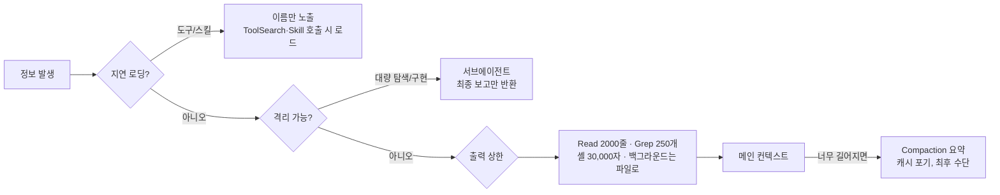

> 컨텍스트 조립과 메인 컨텍스트 오염 방지 — 실제 세션 트랜스크립트로 확인한 내용

- 관찰일: 2026-10-19
- Claude Code 버전: 2.1.303 / 모델: claude-opus-5-5
- 환경: Windows 11, bypass permissions 모드
- 근거 데이터: `~/.claude/projects/C--workspace/<session>.jsonl` (메인)과 `<session>/subagents/agent-*.jsonl` (서브에이전트)

> ⚠️ 이 문서의 수치는 **실제 기록을 측정한 값**입니다. 반면 필드의 의미(`keep`, `tail`, `scope: global` 등)는 이름과 동작을 보고 **추론한 것**이며, 공식 문서로 확인하지는 않았습니다. 추론한 부분에는 _(추정)_ 표시를 달았습니다.

---

## 1. 큰 그림: 에이전트 루프

```text
messages = [사용자 입력 + 주입된 컨텍스트]
loop:
    response = API(system, tools, messages)        # 스트리밍
    messages += response
    if tool_use 없음: break                         # 턴 종료
    for tool_use in response (병렬 가능):
        권한 검사 → PreToolUse hook → 실행 → PostToolUse hook
    messages += tool_results + 새 system-reminder들
```

모델은 "어떤 도구를 어떤 인자로 호출할지"만 JSON으로 내보냅니다. 실제 실행은 하네스(Claude Code 프로그램)가 합니다. 루프 자체는 단순하고, 복잡한 부분은 **무엇을 어떤 순서로 컨텍스트에 넣는가**와 **무엇을 넣지 않는가**입니다.

---

## 2. 컨텍스트 조립

### 2.1 실제 API 요청의 층 구조 (메인 세션)

> 캐시 프리픽스는 **tools → system → messages** 순서로 이어 붙여 계산됩니다.

| 층 | 내용 | 크기 | 캐시 설정 |
|---|---|---|---|
| `tools` (캐시 순서상 맨 앞) | 도구 19개 (그중 2개는 `defer_loading`) | **약 89KB** | system 브레이크포인트까지 함께 캐시 |
| `system[0]` | `"You are Claude Code, Anthropic's official CLI for Claude."` | 82자 | — |
| `system[1]` | 공통 행동 규칙 (보안, 하네스, 메모리 규칙 등) | 3.0KB | `ephemeral, ttl 1h, scope: global` |
| `system[2]` | 세션별 지침 (코드 스타일, 대명사 규칙 등) | 5.9KB | `ephemeral, ttl 1h` |
| `messages` | 환경 정보, 사용자 컨텍스트, 대화 | 계속 증가 | 마지막 메시지에 `ttl 1h` |

**도구 정의가 가장 큰 고정 비용입니다.** 도구별 크기 상위는 다음과 같습니다.

| 도구 | 정의 크기 |
|---|---|
| Artifact | 37,253자 (도구 전체의 약 42%) |
| PowerShell | 9,323자 |
| SendFeedback | 5,537자 |
| Workflow | 5,384자 |
| AskUserQuestion | 4,926자 |

`scope: global`은 이 블록이 사용자나 세션의 경계를 넘어 캐시를 공유한다는 뜻으로 보입니다 _(추정)_. 그래서 가장 안 바뀌는 내용을 가장 앞에 둡니다.

### 2.2 바뀌는 정보는 system이 아니라 messages에 들어간다

작업 디렉터리, git status, 날짜, 이메일, 스킬 목록, MCP 안내문은 **시스템 프롬프트에 없었습니다.** 대화 시작부의 메시지로 주입되어 있었습니다.

```text
messages[0] role=user
  ├─ <system-reminder> 사용자 컨텍스트(이메일, git status)    2,142자
  ├─ <system-reminder> 커밋/PR 서명 규칙                        581자
  └─ 실제 사용자 입력                                            56자
messages[1] role=system
  ├─ "# Environment …" (환경, 스킬 목록, 에이전트 목록 등)    25,714자
  └─ tool_addition × 3  (MCP 도구 정의를 대화 중간에 추가)
...
각 턴 끝 role=system
  └─ <total_tokens>…</total_tokens>
```

트랜스크립트에는 이 주입물들이 `attachment` 레코드로 저장됩니다.

| attachment 타입 | 역할 | 렌더링 위치 |
|---|---|---|
| `environment` | OS, 셸, cwd, git 여부 | system |
| `model` | 모델 ID, 지식 기준일 | system |
| `session_context` | 이메일, git status | user |
| `date` | 오늘 날짜 | system |
| `skill_listing` | 스킬 목록 (**약 37KB**) | system |
| `deferred_tools_delta` | 지연 로딩 도구 이름 목록의 변화분 | system |
| `agent_listing_delta` | 서브에이전트 종류 목록의 변화분 | system |
| `mcp_instructions_delta` | MCP 서버 안내문의 변화분 | system |
| `auto_mode` | 권한 모드 관련 지침 | system |
| `total_tokens_reminder` | 남은 토큰 (매 턴) | system |
| `prompt_snapshot` | 실제로 보낸 프롬프트 스냅샷 (디버깅용) | 전송 안 함 _(추정)_ |

**왜 이렇게 할까요?** git status나 날짜가 system 안에 있으면 값이 바뀔 때마다 system 이후의 캐시 전체가 무효화됩니다. 그래서 변동 정보는 대화 쪽으로 보내서, system과 tools 프리픽스를 **바이트 단위로 고정**합니다. 이 효과는 5장에서 시뮬레이터로 정량 검증했습니다.

### 2.3 변경은 덮어쓰지 않고 delta로 덧붙인다

- 도구 목록이 바뀌면 `deferred_tools_delta`, 에이전트 종류가 바뀌면 `agent_listing_delta`, MCP 안내문이 바뀌면 `mcp_instructions_delta`가 붙습니다.
- MCP 도구가 세션 중간에 연결되면 `tools` 배열을 고치지 않고 **system 역할 메시지 안에 `tool_addition` 블록**으로 정의를 끼워 넣습니다.
- 이와 관련된 베타 플래그로 `mid-conversation-tool-changes-2026-07-01`, `inline-tools-2026-09-15`, `mid-conversation-system-clear-at-2026-08-21`가 켜져 있었습니다.

### 2.4 요청 기록 방식 = append-only 로그

`api-request` 레코드는 직전 요청을 `base`로 참조하고, 앞쪽 `keep`개 메시지를 그대로 재사용하며, 새 `tail`만 덧붙입니다.

```text
요청1: keep=0             tail=5   캐시 BP → messages[4]
요청2: base=요청1 keep=5  tail=3   캐시 BP → messages[7]
요청3: base=요청2 keep=8  tail=3   캐시 BP → messages[10]
요청4: base=요청3 keep=11 tail=3   캐시 BP → messages[13]
```

- 마지막 캐시 브레이크포인트가 꼬리를 따라 **3칸씩 이동**합니다. 한 번 이동할 때 assistant(tool_use) + user(tool_result) + system reminder 묶음이 추가됩니다.
- 과거 메시지를 고치지 않으니, 매 요청이 직전 요청 전체를 캐시에서 읽을 수 있습니다.

메인 세션에서 실제로 측정한 `usage`도 이를 보여줍니다. 매 턴 새로 쓰는 양은 수백에서 수천 토큰이고, 나머지는 전부 캐시 읽기였습니다.

```text
cache_read  59,601 → 62,024 → 63,434 → … → 79,004   (단조 증가)
cache_write  2,423,  1,410,  4,384, …   3,257         (새 꼬리 분량)
input            2,      2,      2, …       4         (캐시 밖 입력 거의 0)
```

### 2.5 그 밖의 요청 파라미터

- `thinking: {type: adaptive}`, `output_config: {effort: medium}`
- `context_management.edits = [{type: clear_thinking_20251015, keep: all}]`: 과거 thinking 블록을 서버에서 정리하는 장치입니다. 지금은 `keep: all`이라 아무것도 지우지 않습니다.
- `max_tokens: 128000`

---

## 3. 실험: 서브에이전트 2개 원샷 실행

### 3.1 실험 설계

성격이 다른 두 작업을 `general-purpose` 에이전트에 백그라운드로 동시에 맡겼습니다.

| | Agent 1 — 탐색형 | Agent 2 — 구현형 |
|---|---|---|
| 과제 | 워크스페이스 하위 프로젝트 14개를 읽기 전용으로 분석 (스택, 규모, 테스트, 공통 패턴, 복잡도 순위) | 프롬프트 프리픽스 캐시 시뮬레이터를 Node.js로 구현하고, 테스트 8개 이상 작성 후 통과 |
| 특징 | 읽을 거리가 방대함 → 결과 압축 능력을 볼 수 있음 | 쓰기, 실행, 검증 루프 |

### 3.2 저장 구조

```text
~/.claude/projects/C--workspace/
├── <session>.jsonl                         ← 메인 트랜스크립트
└── <session>/subagents/
    ├── agent-<id>.jsonl                    ← 자식 트랜스크립트 (완전히 별도 파일)
    └── agent-<id>.meta.json                ← 부모-자식 연결 정보
```

`meta.json` 내용 (실측):

```json
{
  "agentType": "general-purpose",
  "launchedWithDefaults": true,
  "description": "Analyze workspace subprojects deeply",
  "toolUseId": "toolu_…",
  "spawnDepth": 1,
  "requestShape": "background",
  "requestNonInteractive": true,
  "finished": true
}
```

- `toolUseId`: 부모의 `Agent` 도구 호출 하나에 자식 세션 하나가 연결됩니다.
- `spawnDepth: 1`: 중첩 깊이를 추적합니다. 깊이 제한이 있을 것으로 보입니다 _(추정)_.
- `requestNonInteractive: true`: 자식은 사용자에게 질문할 수 없습니다. 3.3절의 도구 목록과도 일치합니다.
- `finished`는 처음엔 없다가 완료되면 추가됩니다.

### 3.3 자식이 받는 컨텍스트: 부모보다 가볍지만 0은 아니다

| 항목 | 메인 | 서브에이전트 |
|---|---|---|
| system 블록 | 3개 (82 / 3,030 / 5,915자) | **2개 (62 / 2,720자)** |
| 도구 수 | 19개 | **13개** |
| 빠진 도구 | — | AskUserQuestion, Workflow, SendFeedback, ScheduleWakeup, ListAgents, ReportFindings |
| 그대로 복제되는 것 | — | `skill_listing` (37KB), `session_context`, `deferred_tools_delta`, `agent_listing_delta`, `mcp_instructions_delta` |
| 부모 대화 내용 | — | **없음** (프롬프트 한 개로 시작) |

즉 서브에이전트는 **부모의 대화 이력은 받지 않지만, 환경과 기능 목록은 대부분 다시 받습니다.** 첫 요청의 프리픽스는 약 33.6K 토큰이었습니다.

### 3.4 측정 결과

| 지표 | Agent 1 (탐색형) | Agent 2 (구현형) |
|---|---|---|
| 소요 시간 | 558초 | 114초 |
| API 요청 수 | 12개 (+ 재시도 2개) | 4개 |
| 도구 사용 | Bash ×11 | Write ×5, Bash ×2 |
| 도구 결과 합계 | 18,405자 | 3,164자 |
| 자식 내부 토큰 (보고값) | 52,163 | 49,720 |
| 첫 요청 캐시 | **write 33,597 / read 0** | **write 10,427 / read 23,584** |
| 마지막 요청 컨텍스트 | 약 50.2K 토큰 | 약 48.1K 토큰 |
| 오류 | 도구 호출 1건이 안전 분류기에 의해 중단됨 | 없음 |

#### 관찰 ①: 에이전트 간 프리픽스 캐시 공유
Agent 1은 첫 요청에서 33,597토큰을 **새로 썼고**, 몇 초 뒤 시작한 Agent 2는 첫 요청에서 **23,584토큰을 캐시에서 읽었습니다.** 두 자식은 서로 다른 세션인데도 system과 tools 프리픽스가 똑같아서 캐시를 공유한 것입니다. 2.1절의 "앞부분은 고정" 원칙이 **에이전트 사이에서도** 이득을 냅니다.

#### 관찰 ②: 자식 내부에서도 append-only
Agent 1의 요청 14개 모두 `keep`이 0 → 2 → 5 → 5 → 8 → 10 → 10 → 13 → … → 31로 단조 증가했습니다. `tail=0`인 요청 2건은 같은 프리픽스를 다시 보낸 경우로, 중단된 호출을 재시도한 것으로 보입니다 _(추정)_.

#### 관찰 ③: 권한 모드가 도구 선택을 바꾼다
Agent 1은 Read, Grep, Glob을 쓸 수 있었는데도 **Bash만 11번** 썼습니다. 자식에게도 `auto_mode` attachment(`bashFirst: true`)가 주입되어 "bypass 모드에서는 Bash로 처리해도 된다"는 지침을 받았기 때문입니다. 하네스가 주입하는 문구가 모델의 행동을 실제로 바꾸는 사례입니다.

#### 관찰 ④: 자식의 오류는 자식 안에서 끝난다
Agent 1의 도구 호출 하나가 안전 분류기에 의해 중단되었습니다. 자식은 이를 `is_error` 도구 결과로 받고 스스로 우회해서 작업을 끝냈습니다. 부모가 받은 건 최종 보고서에 적힌 "한 번은 시스템에 의해 중단됨" 한 줄뿐이었습니다.

### 3.5 메인 컨텍스트에 실제로 들어온 양

| 단계 | 메인에 들어온 것 | 크기 |
|---|---|---|
| 에이전트 실행 | `Agent` 도구 결과 (실행 확인 메시지, ID, 출력 파일 경로, "이 파일을 읽지 마라" 경고) | 1,107자 × 2 |
| 완료 | `<task-notification>` (요약, 최종 보고, usage) | 약 3.4KB / 5.4KB |

**압축률:**

```text
Agent 1:  자식 내부 약 52K 토큰  ──▶  메인에 약 5.4KB (약 1.5~2K 토큰)   ≈ 25~35배 압축
Agent 2:  자식 내부 약 50K 토큰  ──▶  메인에 약 3.4KB (약 1K 토큰)       ≈ 40~50배 압축
```

자식이 읽은 도구 결과 18,405자는 **메인에 한 글자도 들어오지 않았습니다.** 메인이 받은 건 자식이 작성한 보고서뿐입니다.

또한 `Agent` 도구 결과에는 다음 경고가 포함되어 있었습니다.

> "Do NOT Read or tail this file via the shell tool — it is the full subagent JSONL transcript and reading it will overflow your context."

격리를 **도구 결과 문구로도 강제**하는 장치입니다. (이 문서를 쓰면서 자식 트랜스크립트는 내용을 출력하지 않고 타입, 크기, usage만 집계하는 스크립트로 분석했습니다.)

---

## 4. 메인 컨텍스트 오염 방지 메커니즘

관찰 결과를 종합하면 방어선이 네 겹입니다.



| 방어선 | 메커니즘 | 관찰 근거 |
|---|---|---|
| ① 지연 로딩 | 지연 로딩 도구 24개는 이름만 노출되고, `ToolSearch`로 스키마를 불러옴. 스킬도 한 줄 설명만 노출 | `deferred_tools_delta`, `DeferredToolPlaceholder(defer_loading)` |
| ② 격리 | 서브에이전트는 별도 파일과 별도 messages로 돌고, 결과만 반환 | 3.5절의 25~50배 압축 |
| ③ 상한 | 도구별 기본 출력 제한, 백그라운드 출력은 파일로 + 완료 알림 | 도구 설명, `tasks/*.output` |
| ④ 요약 | compaction | (이번 세션에선 발생하지 않음) |

**한계도 관찰됐습니다.**
- `skill_listing`(37KB)은 지연 로딩 대상이 아니라 부모와 모든 자식에 매번 복제됩니다. 스킬이 많을수록 고정 비용이 커집니다.
- 서브에이전트는 시작 비용이 약 33K 토큰입니다. 작은 작업에 쓰면 오히려 손해입니다. 그래서 "파일 하나 찾는 정도는 직접 하라"는 지침이 도구 설명에 들어 있는 것으로 보입니다.

---

## 5. 보너스: 캐시 설계를 시뮬레이터로 검증

Agent 2가 만든 시뮬레이터(sha256 프리픽스 해시 체인, 브레이크포인트 최대 4개, TTL, 비용 배율 쓰기 1.25x / 읽기 0.1x)로 2.2절의 설계를 정량화했습니다. `node --test` 결과 12개가 모두 통과했고, 직접 다시 실행해서 수치를 확인했습니다.

**가정:** system 4,000토큰, 변동 정보(날짜/git status) 150토큰, 사용자 150토큰, 어시스턴트 400토큰, 20턴, 입력 $3/MTok

| 시나리오 | 총 토큰 | 비용(토큰 환산) | 총비용 | 토큰 히트율 |
|---|---|---|---|---|
| (a) append-only, system 고정 | 190,500 | 36,012.5 | $0.1080 | 92.3% |
| (b) 변동 정보를 **system 안에** | 190,500 | 238,125 | **$0.7144** | **0.0%** |
| (c) 변동 정보를 **messages 꼬리에** | 219,000 | 42,140 | $0.1264 | 92.0% |

- **(b)는 (a)보다 약 6.6배 비쌉니다.** 변동 블록 하나가 그 뒤 해시 체인 전체를 깨뜨려 매 턴 전부 미스가 납니다.
- **(c)는 토큰이 15% 늘지만 비용은 17%만 증가합니다.** 이것이 Claude Code가 실제로 택한 방식이고(2.2절), 그 이유가 수치로 확인됩니다.

> 구현 노트: 지정된 조건대로 "브레이크포인트 위치에서만 히트"를 엄격하게 구현하면, 꼬리 브레이크포인트가 매 턴 이동하는 바람에 (a)조차 system만 히트합니다. 그래서 브레이크포인트에서 최대 20블록까지 거슬러 올라가며 찾는 `lookback`을 넣었습니다. 실제 API에도 비슷한 lookback 동작이 있다고 알려져 있지만, 이번에 검증하지는 않았습니다.

---

## 6. 결론: 설계 원칙 정리

1. **프리픽스는 신성불가침.** system과 tools는 바이트 단위로 고정하고, 가장 안정적인 블록에 global 캐시 범위를 둡니다.
2. **변하는 것은 꼬리로.** 환경, 날짜, 상태 변화는 메시지와 attachment로 덧붙입니다. 덮어쓰지 않고 delta로 보냅니다.
3. **로그는 append-only.** 요청은 `base + keep + tail` 구조이고, 캐시 브레이크포인트가 꼬리를 따라 이동합니다.
4. **넣기 전에 걸러라.** 한번 들어간 정보는 compaction 전까지 못 빼므로, 지연 로딩, 서브에이전트 격리, 출력 상한으로 **처음부터 덜 넣습니다.**
5. **격리에는 값이 있다.** 서브에이전트는 시작 비용이 약 33K 토큰이지만 25~50배로 압축된 결과를 줍니다. 큰 작업에만 이득입니다.
6. **하네스의 문구가 곧 제어 수단.** `bashFirst` 지침이나 "이 파일 읽지 마라" 경고처럼, 프로그램이 주입하는 텍스트가 모델 행동을 실질적으로 바꿉니다.

**두 주제의 관계:** 캐시 효율 때문에 과거를 고칠 수 없고, 그래서 대화는 커지기만 합니다. 오염 방지는 이 제약을 감당하기 위해 존재하는 장치입니다.

---

## 7. 재현 방법

실험 도구는 워크스페이스의 `C:\workspace\claude-code-internals\` 폴더에 있습니다.

```text
claude-code-internals/
├── tools/shape.mjs          ← 트랜스크립트 구조 분석 (내용은 출력하지 않고 타입, 크기, 캐시, usage만 집계)
└── cache-sim/               ← 프롬프트 프리픽스 캐시 시뮬레이터 (Node.js 내장 모듈만 사용)
    ├── src/cache.js
    ├── src/scenarios.js
    ├── run.js
    └── test/cache.test.js
```

```bash
# 트랜스크립트 분석
node claude-code-internals/tools/shape.mjs ~/.claude/projects/C--workspace/<session>.jsonl
node claude-code-internals/tools/shape.mjs ~/.claude/projects/C--workspace/<session>/subagents/agent-<id>.jsonl

# 캐시 시뮬레이터
cd claude-code-internals/cache-sim
node --test     # 테스트 12개
node run.js     # 시나리오 a/b/c 비교 표
```

추가 관찰 팁:
- `/context`: 현재 컨텍스트 구성 비율
- `claude --debug`: 내부 로그
- `PreToolUse` hook으로 도구 호출 JSON을 파일에 저장
